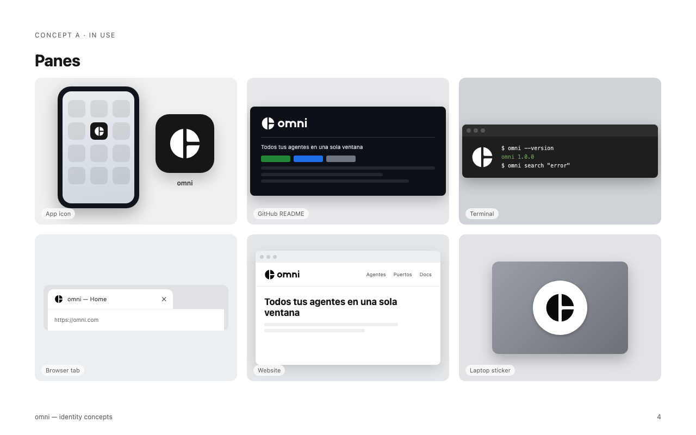

# Marca omni

**Idea:** la "o" de omni partida como un layout de tmux: un pane grande y dos chicos. Todos los agentes
en una sola ventana. Las esquinas internas redondeadas hacen que se lea como ventanas y no como un
gráfico de torta.

## Archivos

| Archivo | Uso |
|---|---|
| `omni-symbol.svg` | Símbolo maestro, tinta sobre fondo claro |
| `omni-symbol-small.svg` | Corte para 32 px o menos: ranuras más anchas, sin esquinas redondeadas |
| `omni-symbol-reversed.svg` | Símbolo claro sobre fondo oscuro (ranuras +2 para compensar la irradiación) |
| `omni-horizontal.svg` / `-reversed.svg` | Símbolo + palabra, uso principal |
| `omni-stacked.svg` | Símbolo sobre la palabra, para espacios cuadrados |
| `omni-macos-icon.svg` / `-small.svg` | Fuente del icono de la app (`build/icon.icns`); el `-small` alimenta 16 y 32 px |
| `web/` | `favicon.svg`, `favicon.ico`, `icon-512.png`, `apple-touch-icon.png` |

## Color

Monocromático, como la app (`styles/tokens.css`):

| Nombre | HEX | Token |
|---|---|---|
| Tinta | `#0a0a0a` | `--bg` |
| Papel | `#fafafa` | `--text` |
| Loseta del icono | `#262626` → `#0a0a0a` | `--surface-2` → `--bg` |

Sin acentos de color en la marca: los colores de estado de la app (naranja, azul, verde) no se usan
en el logo.

## Construcción

- Lienzo de 256; círculo de radio 112 centrado. Ranuras de 26 (20 en el corte chico, 30 en el negativo).
- Partición: un corte vertical en el centro y otro horizontal en la mitad derecha.
- Radio de las esquinas internas: 14.
- Palabra: minúsculas geométricas construidas como trazos (sin fuente). Altura x 116, trazo 32;
  arcos de radio 56 con un hueco de radio 24.

## Reglas

- **Espacio libre:** alrededor de la marca, como mínimo el ancho de un pane chico (≈ ¼ del diámetro).
- **Tamaño mínimo:** símbolo de 16 px (con el corte chico); horizontal de 80 px de ancho.
- **Fondos:** tinta sobre claro o papel sobre oscuro. Sobre fotos, solo en una zona lisa.
- **No:** rotar ni espejar (cambia el layout), cambiar la proporción entre los panes, poner contornos,
  sombras o degradados en el símbolo, ni escribir "omni" con otra fuente al lado del símbolo.

El registro de marca no está verificado: antes de un lanzamiento público conviene buscar en las bases
de marcas registradas.
